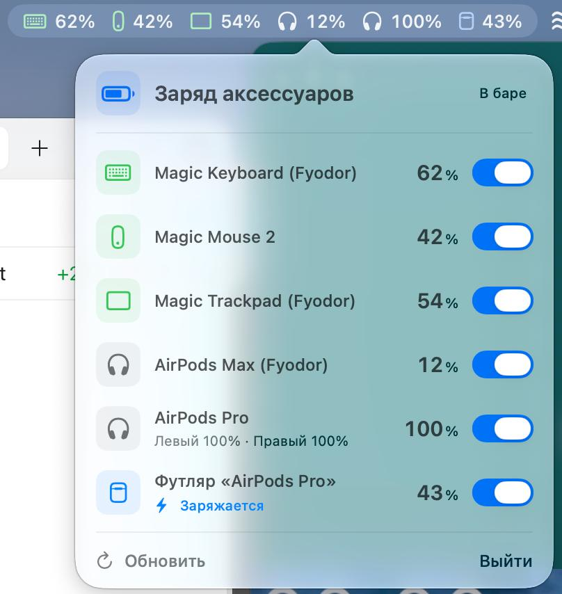

# Accessory Battery for macOS

**English** · [Русский](README.ru.md)

Battery percentages for your keyboard, mouse, trackpad, and headphones in the macOS menu bar.

[Download v1.8 (.dmg)](https://github.com/Kolenter/accessory-battery-macos/releases/download/v1.8/accessory-battery-1.8.dmg) · macOS 12+ · Apple Silicon and Intel




## Install

Open the DMG and drag **Заряд аксессуаров** to **Applications**. That’s the name to look for in Finder or Spotlight.

This build uses an ad hoc signature, so Gatekeeper may block the download. If that happens, build a local copy with the command below.

## Use

Click the menu bar indicator to see the device list. Use the switches under **В баре** to choose what appears in the menu bar. Your choices are saved.

When macOS reports separate AirPods levels, the panel shows the left and right earbuds and gives the case its own row. The app updates about every 15 seconds. Some third-party devices only show their battery level in the manufacturer’s app.

The icon pulses blue while charging. Otherwise it turns red below 8%, or green if the device is connected and has at least 8% left.

## Build

Install Xcode Command Line Tools with Swift 6, then run this from the repository root.

```sh
./build.sh
```

The universal DMG is written to `build/`.
