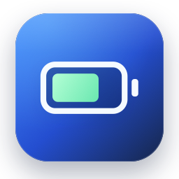
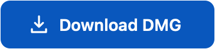

# Accessory Battery for macOS



**English** · [Русский](README.ru.md)

Battery percentages for your keyboard, mouse, trackpad, and headphones in the macOS menu bar.

<a href="https://github.com/Kolenter/accessory-battery-macos/releases/download/v1.9.0/accessory-battery-1.9.0.dmg">
  
</a>

[Release v1.9.0](https://github.com/Kolenter/accessory-battery-macos/releases/tag/v1.9.0) · macOS 12+ · Apple Silicon and Intel

[First launch on macOS](docs/first-launch.md)

## Screenshots


## Install

Open the DMG and drag **Accessory Battery** to **Applications**. On a Mac set to Russian, look for **Заряд аксессуаров** in Finder or Spotlight.

The DMG uses an ad hoc signature, so macOS may ask you to allow the first launch manually.

## Use

Click the menu bar indicator to see the device list. Use the switches under **Menu bar** to choose what appears there. Your choices are saved.

When macOS reports separate AirPods levels, the panel shows the left and right earbuds and gives the case its own row. The app updates about every 15 seconds. Some third-party devices only show their battery level in the manufacturer’s app.

The icon pulses blue while charging. Otherwise it turns red below 8%, or green if the device is connected and has at least 8% left.

Choose **System**, **English**, or **Русский** under **Language** in the panel. The app uses your system language by default.

On macOS 13 or later, turn on **Launch at Login** in the panel. If macOS asks for approval, use the link to **System Settings** next to the switch. On macOS 12, add the app through **System Preferences → Users & Groups → Login Items**.

## Build

Install Xcode Command Line Tools with Swift 6, then run this from the repository root.

```sh
./build.sh
```

The universal DMG is written to `build/`.
