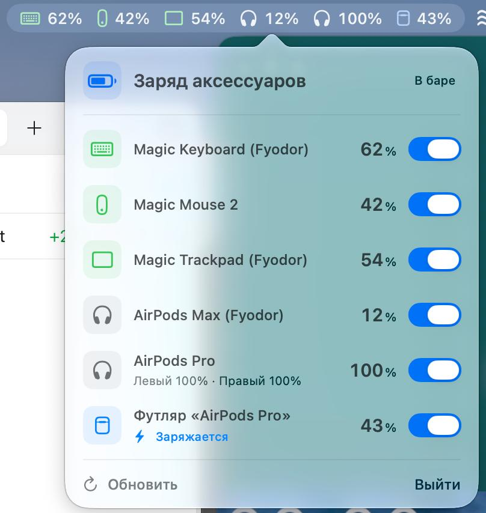

# Заряд аксессуаров

[English](README.md) · **Русский**

Заряд клавиатуры, мыши, трекпада и наушников прямо в строке меню macOS.

[Скачать v1.8 (.dmg)](https://github.com/Kolenter/accessory-battery-macos/releases/download/v1.8/accessory-battery-1.8.dmg) · macOS 12+ · Apple Silicon и Intel




## Установка

Откройте DMG и перетащите **«Заряд аксессуаров»** в **«Программы»**. По этому имени приложение можно найти в Finder или Spotlight.

У сборки локальная подпись, поэтому macOS может заблокировать запуск скачанного приложения. В этом случае соберите свою копию по инструкции ниже.

## Использование

Нажмите на индикатор, чтобы открыть список устройств. Переключатели в колонке **«В баре»** управляют тем, что видно в строке меню. Выбор сохраняется.

Если macOS передаёт отдельные показания AirPods, в панели виден заряд левого и правого наушника. Футляр показан отдельной строкой. Данные обновляются примерно раз в 15 секунд. Заряд некоторых сторонних устройств доступен только в приложении производителя.

При зарядке значок пульсирует синим. Красный появляется при заряде ниже 8%, если устройство сейчас не заряжается. Зелёный означает, что устройство подключено и заряд не ниже 8%.

## Сборка

Установите Xcode Command Line Tools со Swift 6 и запустите команду из корня репозитория.

```sh
./build.sh
```

Универсальный DMG появится в папке `build/`.
