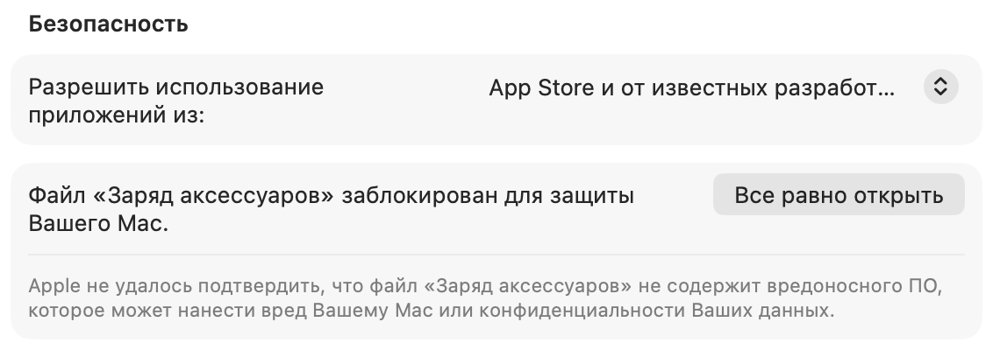
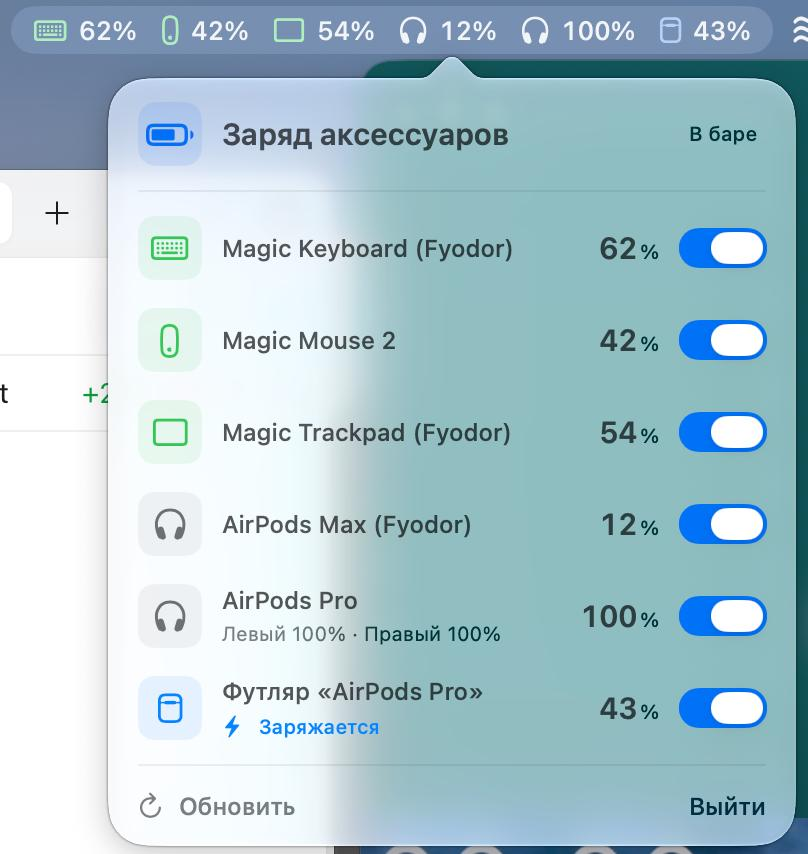

# First launch on macOS

**English** · [Русский](first-launch.ru.md)

1. Download the DMG from the [GitHub release](https://github.com/Kolenter/accessory-battery-macos/releases/latest). Drag **Заряд аксессуаров** to **Applications** and open it.
2. If macOS says Apple couldn’t verify the app, click **Done**.
3. Open **System Settings** → **Privacy & Security**. Scroll to **Security** and click **Open Anyway** next to **Заряд аксессуаров**.
4. Confirm in the next dialog. Use Touch ID or your Mac password if prompted.

The button appears after you try to open the app and is available for about an hour. Your administrator may disable this option on a work or school Mac.

Once the app is open, click the battery percentages in the menu bar to see the panel.

[Apple’s guide](https://support.apple.com/en-us/guide/mac-help/mh40617/mac)
