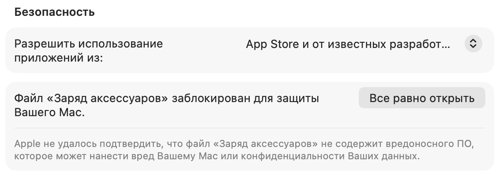
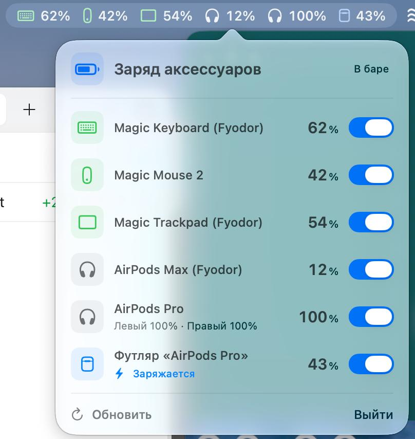

# Первый запуск на macOS

[English](first-launch.md) · **Русский**

1. Скачайте DMG из [релиза на GitHub](https://github.com/Kolenter/accessory-battery-macos/releases/latest). Перетащите «Заряд аксессуаров» в «Программы» и откройте приложение.
2. Если macOS пишет, что Apple не удалось проверить приложение, нажмите **Готово**.
3. Откройте **Системные настройки** → **Конфиденциальность и безопасность**. Прокрутите до раздела **Безопасность** и нажмите **Все равно открыть** рядом с «Заряд аксессуаров».
4. Подтвердите запуск в следующем окне. Если macOS попросит, используйте Touch ID или пароль Mac.

Кнопка появляется после попытки запуска и доступна примерно час. На рабочем или учебном Mac администратор может запретить такое разрешение.

После запуска нажмите на проценты в строке меню, чтобы открыть панель.

[Инструкция Apple](https://support.apple.com/ru-ru/guide/mac-help/mh40617/mac)
